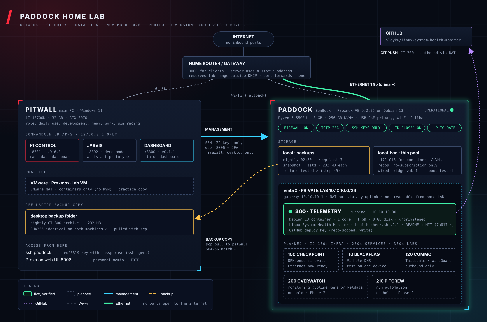

# Phase 2: Repurposing a Laptop into a Hardened Proxmox VE Server

## Objective
Turn a spare laptop (Ryzen 5 5500U, 8 GB RAM, 256 GB NVMe) into a headless, secure, backed-up virtualization host. Manage it entirely from my main PC, and use it to run Linux lab containers.

## Result
| Area | Outcome | How it was verified |
|---|---|---|
| OS + hypervisor | Debian 13 minimal install, then **Proxmox VE 9.2** on top (Proxmox kernel only, GRUB cleaned) | `pveversion`, `uname -r`, dashboard login |
| Storage | LVM thin pool (~171 GiB) for containers and VMs | `pvesm status` |
| Networking | Private lab bridge `vmbr0` (10.10.10.0/24) with NAT out of **any** uplink; containers are not reachable from the home LAN | container ping through NAT; `iptables -t nat -S` |
| Wired uplink | USB gigabit Ethernet on bridge `vmbr1` with a **static address in a reserved range outside DHCP**; Wi-Fi kept as a fallback management path. A systemd unit bound to the adapter brings the bridge up whenever it appears | `ip -br a`, `ip route` (default via the wired bridge), container latency ~12 ms (was ~25 ms on Wi-Fi) |
| Reboot resilience | Full reboot with no manual steps: both bridges up, container auto-starts with internet | reboot test passed on the second attempt (see story 6) |
| Access | Personal Proxmox admin account with **TOTP 2FA**; root kept for emergencies | login test |
| Firewall | Proxmox datacenter firewall **on**, default inbound DROP; SSH (22) and web UI (8006) allowed only from my desktop | SSH and UI work from the desktop; container traffic unaffected |
| SSH | **Key-only** login (ed25519 key with passphrase, ssh-agent); passwords disabled | `sshd -T` shows `passwordauthentication no`; password attempt returns `Permission denied (publickey)` |
| Updates | Free no-subscription repository only; the paid repo that blocked upgrades (HTTP 401) was disabled | clean `apt update`, host + container fully patched |
| Power | Runs headless with the lid closed (systemd-logind drop-in) | closed lid, SSH still answers |
| Backups | Nightly `vzdump` of the lab container at 02:30, keep last 7 | job listed; first archive created |
| Recovery | **Restore tested**: archive restored to a throwaway container, checked, removed | `pct restore` succeeded, config matched |
| Off-host copy | Backup pulled to the desktop | SHA256 identical on both machines |
| Lab container | Debian 13 LXC (unprivileged) running my [Linux System Health Monitor](https://github.com/Sleyk6/linux-system-health-monitor) with a repo-scoped GitHub deploy key | `ssh -T git@github.com`, commits pushed |

## Skills practiced (CompTIA Linux+ / Security+ aligned)
- Installation, partitioning (LVM), bootloader and kernel management (GRUB, `update-grub`)
- Package management: APT sources (deb822), signing keys (keyring SHA256 check), forcing IPv4
- systemd: services, `logind` drop-ins, `reload` vs `restart`, oneshot units bound to a device (`BindsTo=` a `.device` unit)
- Networking: Linux bridges, IP forwarding, NAT (iptables MASQUERADE), static vs DHCP, default-route selection, reading a router's DHCP range before picking a static IP
- Security: least privilege (sudo), MFA, host firewall allow-lists, SSH hardening, secrets hygiene
- Virtualization: Proxmox LXC containers (`pct`, `pveam`), storage pools (`pvesm`)
- Backup and recovery: `vzdump`, scheduled jobs, restore testing, integrity checks (SHA256)
- Git: deploy keys, `.gitignore` for secrets, GitHub no-reply email for privacy

## Troubleshooting stories
1. **APT failing over IPv6.** The network had no working IPv6 route, so `apt` stalled. Fixed with `Acquire::ForceIPv4 "true";` in `/etc/apt/apt.conf.d/99force-ipv4`.
2. **Updates silently blocked.** Installing Proxmox added the paid enterprise repository. Its `401 Unauthorized` made `apt update && apt full-upgrade` stop before upgrading. Disabled it in Node > Updates > Repositories (reversible) and re-ran cleanly.
3. **"Key is invalid" on GitHub.** I'd pasted the key's *fingerprint* instead of the public key, and a screenshot had overwritten the clipboard. Fixed by copying the one-line `ssh-ed25519 ...` key directly.
4. **Wrong-machine commands.** I ran Windows commands in the Linux shell and the reverse. Learned to read the prompt (`PS C:\>` vs `user@host:~$`) before running anything, and to label every command with where it runs.
5. **Hardening without lockout.** I disabled SSH passwords while keeping the existing session open, tested a fresh key login, then confirmed passwords were refused. The rollback was ready the whole time.
6. **A reboot erased my network config.** After adding Ethernet, the first reboot test came up with no lab bridges and the container stopped. Root cause: earlier, the Proxmox web UI's network page had saved a pending `/etc/network/interfaces.new`, and Proxmox applies that file over the real one at boot, wiping every hand edit made since. Fixed by restoring from my backup and adding a device-triggered systemd unit for the USB adapter; the second reboot test passed. Lesson: pick one tool for network changes (I use SSH only) and always reboot-test.
7. **Containers lost internet when the uplink changed.** The NAT rule was tied to the Wi-Fi interface (`-o <wifi-if>`), so when the default route moved to Ethernet, container traffic stopped being translated (DNS failures). Changed it to `! -o vmbr0` ("anything leaving the lab"), so NAT works over whichever uplink is active.

## Key commands
See [build-steps.md](build-steps.md) for the full step-by-step build, including verification and rollback for each change.

## Next
- Monitoring container (Uptime Kuma or Netdata), Pi-hole on one test device, Tailscale for remote access (no open ports)

> Documentation drafted with AI assistance from my own build log; every command was run and verified by me.
